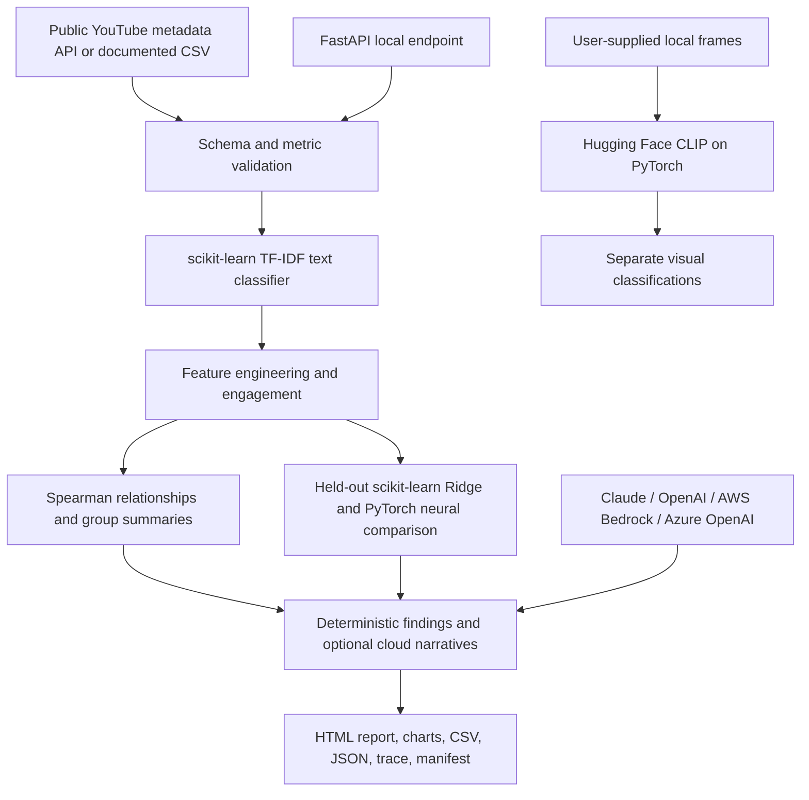

# PRV-201 — VideoLens design and approach / M3 first version

## Purpose and scope

VideoLens investigates associations between YouTube metadata/content categories and engagement. The prototype targets at least 50 observed videos, ten independent human classifications with an 80% agreement target, three numeric feature analyses, visual outputs, and an inspectable execution trace. It is an exploratory pipeline, not a causal study or production virality predictor.

## Architecture

The orchestrator is a plain Python pipeline with explicit stages. This keeps execution reproducible and avoids a framework dependency without a demonstrated need. Each named stack has executable code, rather than a mention in a dependency list. Cloud backends serve the same interface so they can be compared without changing statistics. See README for credentials and invocation.

## Data contract

Required columns: `video_id`, `platform` (`youtube`), `title`, `description`, `views`, `likes`, `comments`, `duration_seconds`, `hashtags`, `data_origin` (`synthetic` or `observed`). Optional: `creator_id`, `collected_at`, `published_at`. IDs must be unique. Counts must be finite nonnegative integers, views positive, duration positive. Missing public metrics are not replaced with zero. One run accepts 10–5000 videos. M3's target is at least 50.

YouTube collector inputs are explicit IDs; selection is a human research decision. The collector records available raw responses and exclusions. It collects no shares, transcripts, follower counts, audio, or full videos. Published age is retained but is not adjusted for in this first version. Future studies should match age or include defensible age/creator controls.

The sample data is 60 fabricated rows generated with seed 201. It contains deliberately constructed relationships for software demonstration. Its results cannot support claims about YouTube. Training text is a separate handwritten seed dataset of 60 examples, not labels inferred from the analysis dataset's engagement.

## Classification and human review

The default text classifier is TF-IDF with unigrams/bigrams followed by logistic regression (`random_state=201`). It learns from `seed_training.csv`. It classifies titles and descriptions only. It does not watch videos. Its seed examples are small and simplistic; model probability scores are not calibrated and real-world accuracy is unknown until independently reviewed.

Categories and labeling rules:

| Label | Dominant purpose |
|---|---|
| education | Teaching a concept, skill, fact, or explanation |
| entertainment | Comedy, performance, reactions, or recreation |
| food | Cooking, recipes, tasting, or food preparation |
| fitness | Exercise, yoga, workouts, or physical training |
| technology | Devices, software, coding, or technical product discussion |

For mixed content, reviewers choose the main purpose and record ambiguity separately in their notes. Reviewers should inspect actual content where available. Preserve initial labels before seeing model outputs. The automatically sampled ten-ID template excludes model labels. Human agreement is exact matching categories / reviewed videos. It is not inter-rater reliability or a population accuracy estimate; ten is a small sample. The readiness flag requires at least ten observed reviews and agreement >=80%; failed targets remain reported.

## Engagement and analysis

`engagement_rate = (likes + comments) / views`. Shares are unavailable and omitted explicitly. This is interaction events per view, not unique engaged viewers. High views alone do not imply high engagement. Rates may exceed one; the validator does not falsely cap interaction events.

Higher performance is engagement strictly above the sample median; ties are lower/equal. This is a descriptive grouping and is not used as a train/test prediction target.

Three numeric features are duration, hashtag count (counted occurrences), and title length in characters. Each is compared with engagement using Spearman rank correlation. Constant inputs are marked not estimable. P-values are exploratory and not corrected for multiple comparisons; they must not be treated as confirmatory significance claims. Category medians and counts provide an additional descriptive comparison.

## Model comparison

scikit-learn Ridge regression predicts continuous engagement from the three numeric features. PyTorch uses a small feedforward network: 3 inputs, 8 ReLU units, 1 output; Adam, learning rate .01, 250 epochs, seed 201. Target standardization and feature standardization use training data only. Both models share train/test rows. A training-mean baseline supports interpretation. MAE is reported in engagement-rate units; multiply by 100 for percentage points. R-squared can be negative and is not accuracy.

With at least four fully identified creators, GroupShuffleSplit holds out creators; otherwise random 25% holdout is disclosed. No engagement-count predictors are included, avoiding direct target leakage. These tiny holdout samples do not justify future-popularity claims. Temporal drift and other confounders remain unaddressed. No production model persistence or deployment prediction endpoint is claimed.

## Vision

Transformers runs zero-shot image classification with `openai/clip-vit-base-patch32` on PyTorch/CPU. Five scene prompts correspond to the category list. Up to three supplied local frames are classified per video, and prompt scores are averaged. Frame selection and scene ambiguity limit validity. Visual classifications are reported separately from text classifications; human agreement currently evaluates text labels. This does not analyze pacing, audio, OCR, or the full video. Model weights require an initial download. No vision execution should be claimed unless frames and outputs exist.

## Cloud integrations and API

- Anthropic SDK: Claude Messages narrative.
- OpenAI SDK: Responses narrative with `store=False`.
- AWS boto3: Bedrock Converse narrative.
- OpenAI SDK with Azure v1 base URL: Azure OpenAI Responses narrative.

All receive computed aggregate statistics only, with instructions to avoid causal claims. User video text is not sent to narrators. Models/deployments are environment-configured. Credentials are never included in output. Timeouts and bounded SDK retries reduce transient failure impact; failures are recorded per provider without discarding local analysis. Cloud prose can still be wrong; numeric Python artifacts are authoritative.

FastAPI exposes `/health`, `/analyze`, and `/docs` on localhost. The metadata-analysis API has no arbitrary file paths, cloud selection, or model-download controls. CLI executes heavy/full-stack runs. The API is synchronous and intended for a local demonstration, not concurrent production workloads.

## Engineering and evidence

Validation rejects duplicates, missing metrics, mixed platforms, invalid origins, nonfinite or negative numeric values, and zero views. Output folders must be empty, preserving evidence. Pipeline failures leave a failure stage in the trace. Model preprocessing is fit on training data only. The manifest records versions, input hashes, output hashes, options, and readiness status. Trace records are stage-level, not fabricated model conversations.

Tests cover invalid data, constant features, creator-held-out splitting, independent review constraints, offline end-to-end outputs, API behavior, and provider contracts with mocks. Mocked cloud tests validate dispatch/response extraction only and are not live API evidence.

## Alignment with the original M2 plan

| Planned item | M3 implementation / deviation |
|---|---|
| One social platform, 50 videos | YouTube selected; collector and templates implemented. Included fixture is synthetic; real collection still required. |
| Metadata and engagement comparisons | Implemented; shares omitted because not obtained by public collector. |
| AI content analysis | Text classifier implemented; independent human validation pending. |
| scikit-learn | Text classifier and Ridge regression implemented. |
| PyTorch | Optional executable neural comparison; requires installed dependency. |
| Hugging Face vision | Optional executable CLIP frame classification; full-video/audio analysis deferred. |
| Claude / OpenAI | Executable configurable narrative adapters; credentials and live runs required. |
| AWS Bedrock / Azure AI | Executable alternate narrative adapters; no infrastructure provisioning claimed. |
| Framework/orchestration | Explicit Python pipeline instead of adding an unnecessary agent framework. |
| Graphs, charts, tables | Standalone HTML report, three PNG plots, CSV summaries, JSON statistics. |
| AI training by prolonged exposure | Replaced with defined seed training, fixed data batches, held-out evaluation, and independent review. Model quality does not deteriorate simply from prolonged exposure. |

## Risks, limitations, and future work

Sampling bias, creator size, video age, unavailable metrics, category ambiguity, small samples, cloud failures, and weak seed training are the principal risks. Mitigations include a written sampling protocol, exclusions log, creator split, honest status reporting, independent labels, and avoiding causal language. Future work should increase labeled data, improve categories, control observation windows, add grouped/temporal cross-validation with more creators, and validate visual content on independently labeled frames.

## Official implementation references

- OpenAI Responses: https://developers.openai.com/api/docs/guides/text?lang=python
- Claude Messages: https://platform.claude.com/docs/en/api/python/messages/create
- AWS Bedrock Converse: https://docs.aws.amazon.com/boto3/latest/reference/services/bedrock-runtime/client/converse.html
- Azure v1 endpoints: https://learn.microsoft.com/en-us/azure/developer/ai/how-to/switching-endpoints
- Transformers zero-shot image classification: https://huggingface.co/docs/transformers/main/tasks/zero_shot_image_classification
- scikit-learn leakage prevention: https://scikit-learn.org/stable/common_pitfalls.html
- PyTorch neural networks: https://docs.pytorch.org/tutorials/beginner/basics/buildmodel_tutorial.html
- YouTube videos.list: https://developers.google.com/youtube/v3/docs/videos/list

API availability depends on your chosen model, account, region, and deployment. Consult your provider's documentation if configuration differs.
